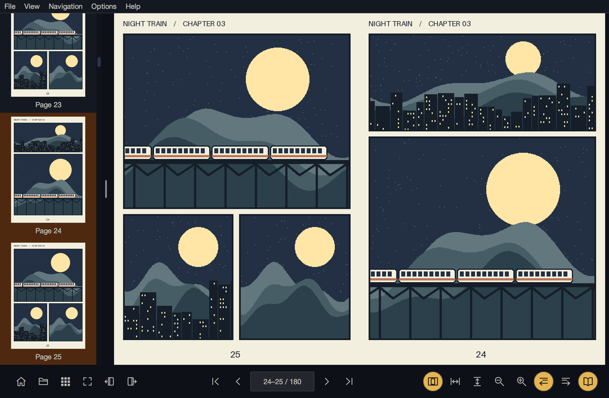
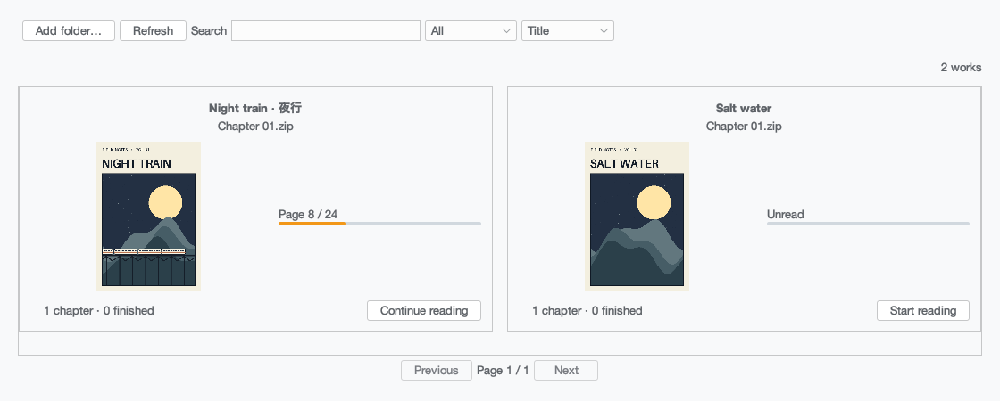

# Yonaka Reader ・ 夜中

A desktop reader for manga, comics and folders of images on macOS, Windows and Ubuntu.
Drop a volume into the window, read a few pages and close it. The next time you open
the book, Yonaka picks up where you left off.

## Install

The native packages for Yonaka Reader 0.13.0 include Java. Building from source requires JDK 25.
The standalone JAR runs on Java 25.

1. Open [builds from the main branch](https://github.com/Saivrem/yonaka-reader/actions/workflows/ci.yml?query=branch%3Amain).
2. Choose a recent successful run. While signed in to GitHub, download the artifact
   for your platform from the **Artifacts** section and extract the downloaded ZIP.
3. Open the package inside.

| Platform | Artifact | Installation |
| --- | --- | --- |
| macOS · Apple Silicon | `YonakaReader-macOS-arm64-dmg` | Open the DMG and drag **Yonaka Reader.app** into Applications. |
| Windows · x64 | `YonakaReader-windows-x64` | Run the MSI, or extract the portable ZIP and launch **Yonaka Reader.exe**. |
| Ubuntu · x64 | `YonakaReader-linux-x64` | Install the DEB with `sudo apt install ./yonaka-reader*.deb`, or extract the portable archive. |

Build artifacts expire after 14 days. The macOS build is ad-hoc signed and the Windows
build is unsigned. See the [packaging guide](docs/packaging.md) for platform details,
local package builds and uninstall instructions.

## Open your first book

- Drop **one folder, image or archive** into the window, or click **Open a book**.
- Read **ZIP and CBZ** archives directly. Loose pages can be **JPEG, PNG or GIF**.
  Pages are sorted naturally, so page 2 comes before page 10.
- Press **Right** for the next page. Press **P** for a two-page spread and choose
  manga (right to left) or comics (left to right) on the toolbar.
- Use **F** for fullscreen, **G** to jump to a page number, or **Shift+G** to pick
  a page from the thumbnail grid.

## Pick up where you left off

**Recently read** keeps your six most recent books or series on the home screen.
Click a card to resume the saved page, direction and spread mode. Volumes in the
same folder can share a card.

Use the **Library** tab to keep a series on your shelf. Choose **Add folder…**,
review the chapters to import, then use **Continue reading** to reopen the last
chapter. Your book files stay where you put them.

## Guides

- [Reading and navigation](docs/reading.md) — gestures, keyboard shortcuts, library import and appearance.
- [Reading history and profiles](docs/storage.md) — data locations, moving a profile and resetting the database.
- [Build and test](docs/building.md) — JDK 25, Gradle, running from source and CI.
- [Native packages](docs/packaging.md) — build a DMG, MSI, DEB or portable distribution.

## License

Yonaka Reader is distributed under the [GNU General Public License v3](LICENSE).
See [third-party notices](THIRD_PARTY_NOTICES.md) for bundled components.
