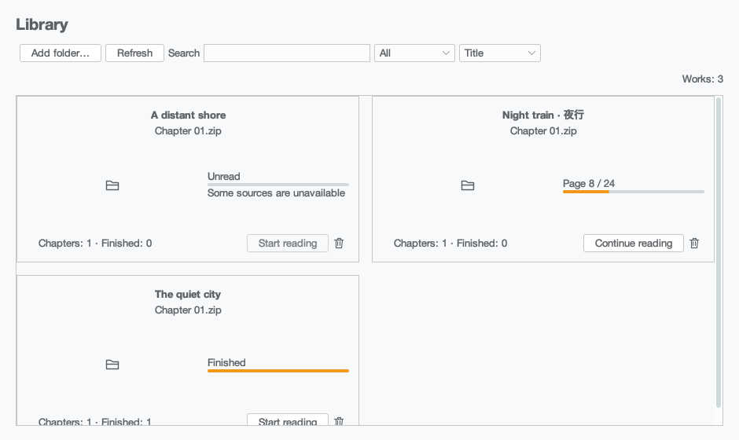
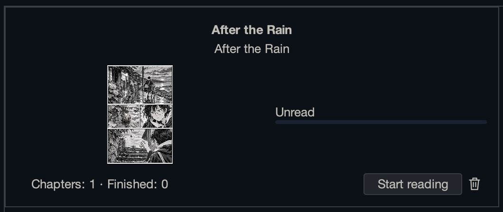

# Yonaka Reader ・ 夜中

A desktop reader for manga, comics and folders of images on macOS, Windows and Ubuntu.
Drop a volume into the window, read a few pages and close it. The next time you open
the book, Yonaka picks up where you left off.

## Install

The native packages for Yonaka Reader 0.22.0 include Java. Building from source requires JDK 25.
The standalone JAR runs on Java 25.

Download the installer or portable package from the [latest release](https://github.com/Saivrem/yonaka-reader/releases/latest).
Native packages include Java; extract portable archives completely before launching.

| Platform | Package | Installation |
| --- | --- | --- |
| macOS · Apple Silicon | DMG | Open the DMG and drag **Yonaka Reader.app** into Applications. |
| Windows · x64 | MSI or ZIP | Run the MSI, or extract the portable ZIP and launch **Yonaka Reader.exe**. |
| Ubuntu · x64 | DEB or TAR.GZ | Install the DEB with `sudo apt install ./YonakaReader-*-linux-x64.deb`, or extract the portable archive. |

Each release also includes the standalone JAR and `SHA256SUMS`. The macOS build is
ad-hoc signed and the Windows build is unsigned. See the [packaging guide](docs/packaging.md)
for platform details, local builds and uninstall instructions.

## Open your first book

- Drop **one folder, image or archive** into the window, or click **Open a book**.
- Read **ZIP and CBZ** archives directly. Loose pages can be **JPEG, PNG or GIF**.
  Pages are sorted naturally, so page 2 comes before page 10.
- Press **Right** for the next page. Press **P** for a two-page spread and choose
  manga (right to left) or comics (left to right) on the toolbar. Press **Shift+P** to shift the pairing by one page.
- Use **F** for fullscreen, **G** to jump to a page number, or **Shift+G** to pick
  a page from the thumbnail grid.

## Toolbar controls

The bottom toolbar has three groups. Within each group, the buttons appear in the order shown below.

| Books and views | Page navigation | Zoom and reading mode |
| --- | --- | --- |
|  Home · recent books (`Cmd/Ctrl+Shift+H`) |  First page |  Fit the whole page or spread |
|  Library (`Cmd/Ctrl+Shift+L`) |  Previous page or spread |  Fit page width |
|  Open a book | **24 / 180** · Jump to a page |  Fit page height |
|  Browse the page grid |  Next page or spread |  Zoom out |
|  Toggle fullscreen |  Last page |  Zoom in |
|  Previous volume |  |  Read right to left |
|  Next volume |  |  Read left to right |
|  |  |  Toggle two-page spreads |

Shortcuts shown here are defaults; change them in **Settings → Shortcuts**.

## Pick up where you left off

**Home** keeps your six most recent books or series.
Click a card to resume the saved page, direction and spread mode. Volumes in the
same folder can share a card.

Use **File → Library**, the Library toolbar button or **Cmd/Ctrl+Shift+L** to keep a series on your shelf. Choose **Add folder…**,
review the chapters to import, then use **Continue reading** to reopen the last
chapter. Scroll through the cards to browse the collection. Opening Library again
returns to the top of the shelf.

To remove a work from the library, click the trash button in the lower-right
corner of its card and confirm. Your book files stay where you put them.

## Guides

- [Reading and navigation](docs/reading.md) — gestures, keyboard shortcuts, library import and appearance.
- [Reading history and profiles](docs/storage.md) — data locations, moving a profile and resetting the database.
- [Build and test](docs/building.md) — JDK 25, Gradle, running from source and CI.
- [Native packages](docs/packaging.md) — build a DMG, MSI, DEB or portable distribution.

## License

Yonaka Reader is distributed under the [GNU General Public License v3](LICENSE).
See [third-party notices](THIRD_PARTY_NOTICES.md) for bundled components.

Copyright (C) 2026 Denis Sheviakov

## Translation
Open **Settings → Translations** to add or edit a language, import a JSON file, or export a translation to share. See the [translation guide](docs/translations.md).
